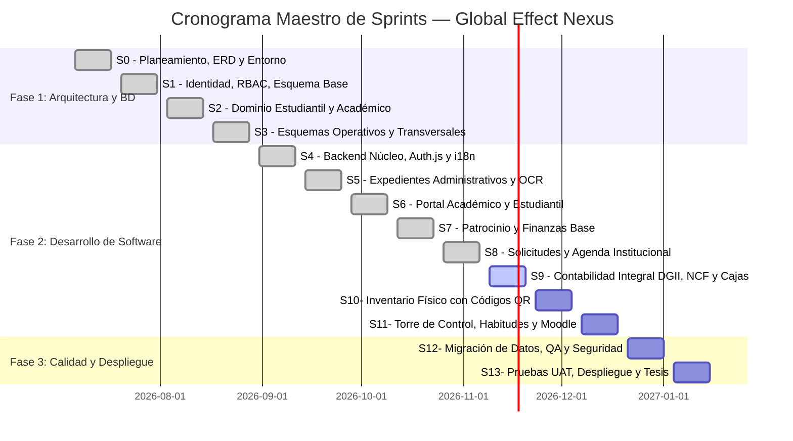
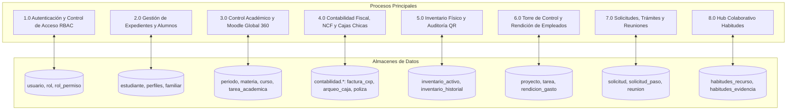

# UNIVERSIDAD CATÓLICA DEL CIBAO (UCATECI)
## Escuela de Ingeniería en Sistemas y Computación
### PROYECTO FINAL DE GRADO (PROYECTO INTEGRADOR DE CONOCIMIENTOS)

---

# GLOBAL EFFECT NEXUS
### Sistema Web Inteligente de Planificación de Recursos Empresariales (ERP) y Gestión Académica con Portal del Estudiante Integrado

**Sustentantes:**
- **Gabriela García** | Matrícula: 20230105
- **Dauris Santana**  | Matrícula: 20230253

**Asesor Académico y Metodológico:** Escuela de Ingeniería en Sistemas y Computación  
**Institución Beneficiaria:** Fundación Global Effect Inc.  
**Ubicación:** La Vega, República Dominicana  
**Año Académico:** 2026 – 2027  

---

## ÍNDICE GENERAL DE ENTREGABLES

1. [PRIMERA ENTREGA: Contexto, Planteamiento del Problema, Alcance y Justificación](#primera-entrega--proyecto-final-de-grado)
2. [SEGUNDA ENTREGA: Limitaciones, Planificación, Plan de Visualización y Objetivo General](#segunda-entrega--proyecto-final-de-grado)
3. [TERCERA ENTREGA: Objetivos Específicos, Marco Teórico y Vulnerabilidad del Sistema](#tercera-entrega--proyecto-final-de-grado)
4. [CUARTA ENTREGA: Diagrama Entidad-Relación, Diagrama de Flujo de Datos y Diccionario](#cuarta-entrega--proyecto-final-de-grado)
5. [QUINTA ENTREGA: Estándares del Sistema, Reglas de Negocio y Diseño de Reportes](#quinta-entrega--proyecto-final-de-grado)
6. [SEXTA ENTREGA: Introducción, Conclusiones y Bibliografía](#sexta-entrega--proyecto-final-de-grado)

---

# PRIMERA ENTREGA — PROYECTO FINAL DE GRADO

## 1. Descripción General del Proyecto

El presente proyecto consiste en la investigación, análisis, diseño y desarrollo de **Global Effect Nexus**, un sistema integral de Planificación de Recursos Empresariales (ERP) con portal del estudiante integrado, arquitectura de control patrimonial mediante códigos QR y subsistema contable ajustado estrictamente a la normativa de la Dirección General de Impuestos Internos (DGII) de la República Dominicana.

La plataforma tiene como propósito unificar, automatizar y blindar los flujos de trabajo administrativos, académicos, financieros y operativos de la **Fundación Global Effect**, una organización sin fines de lucro (ONG) dedicada a la formación integral, liderazgo y rescate de jóvenes en condiciones de vulnerabilidad en la provincia de La Vega y zonas aledañas.

La institución gestiona de manera simultánea una amplia cartera de programas sociales:
- **Estudiantes Universitarios Becados:** Cobertura de matrícula, estipendios y seguimiento de índice académico (GPA).
- **Career Institute (Educación Técnica):** Formación especializada en áreas técnicas y de servicios.
- **Academia de Liderazgo:** Acompañamiento en valores cívicos y liderazgo comunitario.
- **Casa de Herramientas y Talleres Prácticos:** Préstamo y uso de maquinaria, equipos y herramientas de oficios.
- **Programa Juan Bosch y Proyectos de Extensión:** Mentoría comunitaria y proyectos de impacto barrial.
- **Red de Alianzas en Liceos Secundarios (Habitudes Hub):** Docencia formativa presencial impartida por colaboradores de la fundación en escuelas públicas.
- **Comedor Comunitario y Servicios Alimentarios:** Raciones alimenticias diarias para beneficiarios.

Cada una de estas ramas genera un volumen crítico de información distribuida: expedientes socioeconómicos y médicos de estudiantes, rendición de gastos en efectivo y con facturas fiscales por parte del personal operativo, control de inventario de equipos y mobiliario, libros de banco, cuadres de caja chica con denominación física y reportes financieros hacia patrocinadores internacionales y entidades reguladoras del Estado dominicano.

El sistema unifica estas operaciones a través de **seis portales web especializados por rol**:
1. **Portal Administrativo (Dirección y Superadmin):** Gobierno del sistema, auditoría general, asignación de proyectos por rol y configuración global.
2. **Portal del Estudiante:** Autoconsulta de expediente, seguimiento de beca, solicitud de trámites académicos y acceso al aula virtual Global 360.
3. **Portal Docente:** Gestión de asignaturas, calificaciones, registro de asistencia y aula virtual interactiva con vista de estudiante.
4. **Portal de Contabilidad:** Centro de control fiscal exclusivo para contables y auditores, con soporte de Comprobantes Fiscales (NCF), reportes 606/607 de la DGII, conciliación bancaria, cajas chicas con arqueo físico y bitácora con hash SHA-256.
5. **Portal Habitudes Hub:** Espacio colaborativo para docentes en liceos, con repositorio de presentaciones y carga móvil de evidencias fotográficas de clases.
6. **Portal de Rendición y Torre de Control del Empleado ("Lo que me toca hoy"):** Panel de productividad individual con tareas prioritarias del día, bitácora de trabajo y formulario de rendición de gastos con extracción asistida por OCR.

---

## 2. Planteamiento del Problema

La Fundación Global Effect ha experimentado un incremento exponencial en su matrícula de beneficiarios y en la asignación de presupuestos operativos donados por entidades filantrópicas locales e internacionales. Sin embargo, este crecimiento físico no vino acompañado de una plataforma tecnológica acorde, originando una profunda brecha operativa:

1. **Riesgo Fiscal y Regulatorio ante la DGII:** Las transacciones económicas se gestionaban en hojas de cálculo aisladas sin validación formal de Números de Comprobante Fiscal (NCF tipo B01, B02, B14, B15 y E31) ni cálculo estandarizado de retenciones de ITBIS e ISR (Norma General 06-2018). Esta deficiencia exponía a la fundación a inconsistencias y sanciones fiscales severas ante la DGII en la remisión de los Formatos 606 y 607.
2. **Pérdida de Trazabilidad en Activos Físicos:** La fundación posee un inventario valioso de mobiliario, equipos tecnológicos de cómputo, plantas eléctricas y herramientas industriales en la Casa de Herramientas. Al no contar con una codificación física unívoca ni etiquetas matriciales (códigos QR), los activos sufrían extravíos, deterioros no reportados y falta de asignación de custodios responsables.
3. **Descontrol en la Rendición de Gastos de Empleados:** El personal que ejecuta compras diarias para talleres o mandados comunitarios reportaba comprobantes en papel físico de manera tardía, provocando descuadres en los fondos de caja chica y retrasos en la liquidación de anticipos.
4. **Dispersión en el Acompañamiento Académico y Extinción del Área Psicológica:** Tras el cierre formal del departamento de Psicología de la fundación en octubre de 2026, los expedientes de los estudiantes quedaron bajo custodia administrativa. La coordinación de citas requería transformarse urgentemente en una agenda de reuniones y mentoría institucional abierta a todo el personal, eliminando la duplicidad de registros confidenciales.
5. **Aislamiento en la Docencia en Liceos y Talleres Virtuales:** Los facilitadores del programa Habitudes en centros educativos públicos carecían de un repositorio común para sincronizar sus presentaciones multimedia y subir evidencias fotográficas en tiempo real desde sus teléfonos móviles. Asimismo, las jornadas formativas semestrales (Global 360) carecían de un aula virtual tipo Moodle con control riguroso de fechas de entrega y límites de archivos por peso y formato.

**Pregunta de Investigación:**  
*¿De qué manera el diseño e implementación de un sistema web integral ERP inteligente (Global Effect Nexus), sustentado en Next.js, PostgreSQL y autenticación RBAC granular, optimiza el cumplimiento fiscal ante la DGII, asegura la trazabilidad patrimonial de activos mediante códigos QR, agiliza la rendición de cuentas operativa y unifica el seguimiento académico de los beneficiarios de la Fundación Global Effect?*

---

## 3. Alcance del Proyecto (Criterios SMART)

| Criterio | Dimensión | Definición Específica del Proyecto Global Effect Nexus |
| :--- | :--- | :--- |
| **S** | **Específico** *(Specific)* | Desarrollar un ERP institucional integral estructurado en **30 módulos funcionales** y **6 portales web**, que cubra: Contabilidad fiscal DGII (NCF, libros de banco, cajas chicas con desglose por billetes/monedas y alerta de fraude $\ge$ RD$200, retenciones y formatos 606/607); Inventario físico de activos fijos con etiquetas QR de alta resolución y lector móvil por cámara; Aula Virtual Global 360 estilo Moodle; Torre de Control de Tareas del empleado ("Lo que me toca hoy"); Rendición de gastos con OCR; y Hub Colaborativo Habitudes. |
| **M** | **Medible** *(Measurable)* | Se constatará mediante: 100% de los 6 portales operativos; generación exitosa y validación sintáctica de los reportes 606 y 607 de la DGII; escaneo funcional de códigos QR en menos de 1 segundo mediante cámara móvil; y migración verificada de al menos el 30% de los expedientes históricos y transacciones durante la fase de validación (S12). |
| **A** | **Alcanzable** *(Achievable)* | El sistema se construye sobre un stack moderno dominado por los sustentantes: **Next.js 16 (App Router)**, **React 19**, **Tailwind CSS 4**, **PostgreSQL 17** en Supabase mediante consultas SQL parametrizadas directas (`pg`, sin ORM), Auth.js y librerías estándares de la industria (`qrcode`, `canvas-confetti`, `zod`). |
| **R** | **Realista** *(Realistic)* | La solución se focaliza en las operaciones internas de la fundación en La Vega. Quedan explícitamente fuera: interconexión SOAP/REST directa en tiempo real con los servidores tributarios de la DGII (se generan los archivos de importación oficiales requeridos por la institución); pasarelas de pago electrónico con tarjeta de crédito; y desarrollo de apps nativas compiladas para iOS/Android (sustituidas por diseño web responsivo de alto rendimiento). |
| **T** | **Temporal** *(Time-bound)* | Ejecutado en 14 sprints quincenales (julio 2026 – enero 2027), con entrega final y sustentación académica pautada para el ciclo académico correspondiente de UCATECI. |

---

## 4. Justificación

### 4.1 Naturaleza y Urgencia del Problema
Operar una entidad receptora de fondos sin un módulo contable de partida doble que valide NCFs ni controle cajas chicas expone a la institución a pasivos contingentes, pérdidas por fraude interno y cuestionamientos legales por parte del fisco dominicano. Paralelamente, la ausencia de control físico sobre herramientas de alto valor económico ponía en riesgo el patrimonio institucional.

### 4.2 Razones Técnicas y Metodológicas
Frente al paradigma de emplear sistemas comerciales genéricos y costosos que no encajan en la realidad comunitaria, Global Effect Nexus se fundamenta en código abierto robusto:
- **PostgreSQL 17 nativo:** Manejo transaccional estricto (ACID), integridad referencial en cascada, esquemas dedicados (`contabilidad`, `public`) y búsquedas vectoriales con `pgvector`.
- **Acceso a datos sin ORM (`node-postgres`):** Permite auditoría visual del 100% de las consultas SQL, optimización a nivel de milisegundos y erradicación total de vulnerabilidades por inyección SQL mediante parámetros obligatorios (`$1, $2, ...`).
- **Control de Acceso Basado en Roles (RBAC):** La seguridad de datos sensibles (expedientes de menores, comprobantes financieros, registros de auditoría) queda blindada en la capa del servidor mediante políticas de sesión inalterables.

### 4.3 Razones Sociales e Institucionales
La fundación recupera horas-hombre que anteriormente se desperdiciaban en archivar papeles, conciliar hojas de cálculo y buscar herramientas extraviadas. Los donantes internacionales obtienen una ventana de transparencia financiera con balances trazables e informes de impacto medibles.

### 4.4 Pertinencia Académica (UCATECI)
Constituye un Proyecto Integrador de Conocimientos que sintetiza las disciplinas medulares de la Ingeniería en Sistemas y Computación: ingeniería de software, arquitectura de sistemas distribuidos, optimización de bases de datos relacionales, auditoría de sistemas de información y seguridad informática.

---

## 5. Posicionamiento del Proyecto

Global Effect Nexus se posiciona bajo el lema institucional:
> **"Menos tiempo administrando papeles, más tiempo transformando vidas con transparencia y rigor técnico."**

Su propuesta de valor se articula en 4 pilares:
1. **Dirección y Junta Directiva:** Tablero en tiempo real con salud financiera, estado del patrimonio físico e indicadores de rendimiento de becas.
2. **Departamento Contable:** Tranquilidad fiscal absoluta: conciliaciones cuadradas, comprobantes fiscales NCF validados, arqueos de caja con desglose físico y libros auxiliares al día.
3. **Colaboradores y Docentes:** Una torre de control diaria para priorizar tareas, rendir cuentas en segundos mediante fotos a facturas y acceder a recursos didácticos compartidos.
4. **Estudiantes y Familias:** Autonomía para gestionar constancias, consultar su historial académico y participar en aulas virtuales modernas.

---

# SEGUNDA ENTREGA — PROYECTO FINAL DE GRADO

## 1. Limitaciones del Proyecto

Para definir formalmente las fronteras de investigación e implementación del sistema, se establecen las siguientes delimitaciones funcionales y operativas:

1. **Gestión Fiscal con la DGII:** El sistema genera y valida la estructura sintáctica de los Números de Comprobante Fiscal (NCF) y procesa los archivos normativos oficiales para los **Formatos 606 (compras)** y **607 (ventas/ingresos)** conforme a la Norma General 06-2018. Sin embargo, no realiza el timbrado electrónico ni el envío telemático en tiempo real vía Web Services SOAP/REST hacia la DGII, requiriendo que el contador descargue el archivo oficial generado por el sistema y lo remita a través de la Oficina Virtual (OFV) de la DGII.
2. **Plataforma y Dispositivos:** El sistema no incluye aplicaciones móviles nativas publicadas en tiendas (Google Play Store o Apple App Store). Todas las funcionalidades móviles —incluyendo el escaneo de códigos QR de inventario y la captura fotográfica de evidencias de Habitudes— se ejecutan mediante aplicaciones web progresivas responsivas (PWA/Next.js) que acceden al hardware de la cámara a través del API estándar `navigator.mediaDevices`.
3. **Pagos y Cobranzas Bancarias:** La plataforma no actúa como pasarela transaccional de pagos con tarjetas de crédito/débito en línea. El módulo de contabilidad gestiona y concilia registros de depósitos, transferencias bancarias y cheques emitidos.
4. **Modelo de Tenencia (Multi-tenancy):** El software está diseñado bajo un modelo de inquilino único (*single-tenant*), configurado exclusivamente para la infraestructura de la Fundación Global Effect en La Vega.
5. **Alcance de los Asistentes de Inteligencia Artificial:** Los componentes de IA (extracción OCR de facturas y búsqueda semántica con `pgvector`) emplean modelos fundacionales externos de alta capacidad mediante invocaciones seguras en el servidor; el alcance del proyecto no contempla el entrenamiento propio de modelos de lenguaje natural (*LLMs from scratch*).
6. **Descarte Definitivo del Módulo Clínico de Psicología:** Conforme a la reestructuración orgánica de la fundación (octubre 2026), el departamento de Psicología fue disuelto. Los expedientes de estudiantes son estrictamente administrativos y no registran diagnósticos clínicos ni notas terapéuticas.

---

## 2. Planificación del Proyecto

El desarrollo se planificó en **14 sprints quincenales** (aproximadamente 7 meses calendario, julio 2026 – enero 2027), estructurados en tres fases consecutivas:



### 2.1 Camino Crítico y Dependencias
El camino crítico del sistema exige que la arquitectura de base de datos relacional y el subsistema de autenticación RBAC queden estabilizados previamente antes de admitir transacciones financieras o altas de inventario. En particular:
- El esquema `contabilidad` requiere la normalización previa de la tabla `usuario` y el catálogo de cuentas de doble entrada.
- El módulo de **Inventario de Activos con QR** depende de la tabla `usuario` para la asignación de responsables y custodios.
- La **Torre de Control del Empleado** unifica las asignaciones de proyectos gobernadas por el superadministrador, consumiendo las tablas de tareas y rendiciones de gastos.

---

## 3. Plan de Visualización y Difusión Institucional

El plan de adopción y comunicación de la plataforma articula mecanismos internos y externos:
1. **Portal Público y Landing Page Institucional:** Ventana abierta a la comunidad para informar sobre la misión de la fundación, solicitar voluntariado y permitir la inscripción diaria al comedor comunitario.
2. **Transparencia Financiera hacia Donantes:** Informes financieros ejecutivos descargables en formato PDF con conciliación de ingresos por patrocinador versus egresos por programa.
3. **Demostración Práctica con Terminal Móvil:** Sesiones de inducción en la Casa de Herramientas y aulas de la fundación demostrando el escaneo en vivo de etiquetas QR sobre maquinaria y activos tecnológicos.
4. **Defensa de Tesis de Grado en UCATECI:** Presentación formal ante el jurado evaluador universitario exhibiendo métricas de desempeño, arquitectura de software y consistencia de datos en producción.

---

## 4. Objetivo General

**Diseñar, desarrollar e implementar el sistema web inteligente de planificación de recursos empresariales (ERP) y gestión académica "Global Effect Nexus", sustentado en una arquitectura Next.js 16 y PostgreSQL 17 sin intermediación de ORM, con control de acceso basado en roles (RBAC), módulo de contabilidad formal homologado a la normativa de la DGII, trazabilidad física de activos mediante códigos QR y herramientas colaborativas de docencia y productividad, con el propósito de centralizar las operaciones de la Fundación Global Effect, blindar la rendición de cuentas financiera y optimizar el acompañamiento integral de los beneficiarios en La Vega, República Dominicana.**

---

# TERCERA ENTREGA — PROYECTO FINAL DE GRADO

## 1. Objetivos Específicos

1. **E1 (Base de Datos Relacional Normalizada):** Diseñar, normalizar (1NF a 3NF) e implementar el esquema relacional en PostgreSQL 17 con esquemas segregados (`public` y `contabilidad`), abarcando más de 70 tablas estructuradas con restricciones de clave foránea, triggers de auditoría automática y soporte vectorial mediante `pgvector`.
2. **E2 (Control de Acceso y Autenticación RBAC):** Implementar la capa de identidad con Auth.js (NextAuth v5), sesiones JWT cifradas y autorización estricta a nivel de servidor (`requerirUsuario`, `requerirRol`, `requerirPermiso`) para seis portales especializados.
3. **E3 (Contabilidad Integral y Cumplimiento DGII):** Desarrollar el módulo contable con catálogo formal de cuentas, validación estricta de Números de Comprobante Fiscal (NCF tipos B01, B02, B14, B15, E31), generación de los reportes fiscales normativos **Formato 606 y Formato 607**, libros de banco y control de caja chica con desglose físico por denominación y alerta de descuadre $\ge$ RD$200.
4. **E4 (Inventario Físico con Códigos QR):** Desarrollar el módulo de control patrimonial para registro de activos (mobiliario, computadoras, herramientas industriales), generación e impresión de etiquetas QR de alta resolución con branding institucional, y lector móvil integrado con la cámara del dispositivo para auditorías en sitio.
5. **E5 (Torre de Control del Empleado y Rendición de Gastos):** Construir el panel diario de productividad ("Lo que me toca hoy") con estados de tareas (`por_hacer`, `en_progreso`, `en_revision`, `completada`), asignación de proyectos por rol por parte del superadministrador, y formulario de rendición de gastos con extracción de datos de facturas mediante OCR.
6. **E6 (Aula Virtual Global 360 y Hub Habitudes):** Desarrollar el entorno de aprendizaje virtual semestral estilo Moodle con control de entregas por extensiones y peso (MB), vista dual "Ver como estudiante" para docentes, y repositorio multimedia colaborativo con subida de evidencias fotográficas para liceos.
7. **E7 (Expedientes y Agenda Institucional):** Implementar la gestión administrativa de expedientes estudiantiles y la agenda unificada de reuniones para todo el personal y alumnos, reemplazando el antiguo esquema de citas psicológicas.
8. **E8 (Auditoría Inmutable y Separación de Funciones):** Implementar la bitácora transaccional (`audit_log`) con hash SHA-256 encadenado y flujo de solicitudes y aprobaciones con separación de funciones (nadie aprueba su propia solicitud; segundo nivel obligatorio de dirección).

---

## 2. Marco Teórico

### 2.1 Next.js 16 App Router y Server Actions frente a SPAs Tradicionales
Las aplicaciones de página única (SPA) tradicionales descargan pesados paquetes de JavaScript al cliente y exponen APIs REST o GraphQL públicas que incrementan la superficie de ataque. Next.js 16 con App Router adopta una arquitectura basada en **React Server Components (RSC)** y **Server Actions**, ejecutando la lógica de negocio, validaciones y consultas SQL directamente en el entorno seguro del servidor. Esto garantiza que las credenciales de base de datos nunca viajen al navegador y reduce la latencia en la interacción con el usuario.

### 2.2 PostgreSQL 17 sin ORM (Consultas SQL Parametrizadas)
Los Mapeadores Objeto-Relacional (ORMs) convencionales introducen capas de abstracción innecesarias, generan consultas SQL subóptimas y complican la implementación de transacciones complejas. En Global Effect Nexus, la comunicación con PostgreSQL se gestiona mediante el cliente `pg` (`node-postgres`) utilizando **únicamente consultas parametrizadas manuales** (`$1, $2, ...`), garantizando:
- Protección matemática y estructural contra inyecciones SQL.
- Inspección directa del plan de ejecución (`EXPLAIN ANALYZE`).
- Manejo granular de transacciones ACID (`BEGIN`, `COMMIT`, `ROLLBACK`) en transferencias contables y liquidación de cajas chicas.

### 2.3 Normativa Tributaria y Comprobantes Fiscales en República Dominicana (DGII)
La Dirección General de Impuestos Internos (DGII), en el marco de la Ley 11-92 (Código Tributario) y el Decreto 254-06, regula la emisión de Números de Comprobante Fiscal (NCF) para validar costos y gastos deducibles del Impuesto sobre la Renta (ISR) y sustentar créditos del Impuesto a las Transferencias de Bienes Industrializados y Servicios (ITBIS). La Norma General 06-2018 exige a las entidades remitir mensualmente el **Formato 606 (compras)** y **Formato 607 (ventas/ingresos)** con detalle por tipo de gasto, RNC/Cédula del proveedor, fecha de retención y montos gravados/exentos.

### 2.4 Control Patrimonial y Codificación Matricial QR (ISO/IEC 18004)
El código QR (*Quick Response Code*) es un sistema matricial bidimensional capaz de almacenar cadenas alfanuméricas de alta densidad con corrección de errores (Reed-Solomon). Su aplicación en inventarios de activos fijos permite que los auditores verifiquen la existencia física de un equipo en segundos mediante la cámara de un teléfono inteligente, registrando la geolocalización o sede donde se efectuó la lectura.

### 2.5 Criptografía en Auditoría y Trazabilidad Transaccional
Para impedir la alteración retroactiva de pólizas contables y cuadres de caja, el sistema implementa firmas criptográficas basadas en el algoritmo **SHA-256**, generando un hash representativo de cada transacción concatenado al hash del registro anterior (patrón de cadena de bloques local en base de datos), asegurando la no repudiación de las operaciones.

---

## 3. Vulnerabilidad y Seguridad del Sistema

### 3.1 Levantamiento de Amenazas

| ID | Amenaza Identificada | Vector de Ataque | Impacto Institucional |
| :--- | :--- | :--- | :--- |
| **AM-01** | **Inyección SQL (SQLi)** | Parámetros maliciosos en formularios de búsqueda o filtros contables. | Acceso o destrucción total de la base de datos institucional. |
| **AM-02** | **Inconsistencia Fiscal ante la DGII** | Registro de NCF duplicados, facturas no válidas para crédito fiscal o montos erróneos en el 606. | Multas pecuniarias, pérdida de exención de ONG e investigaciones fiscales. |
| **AM-03** | **Fuga de Fondos en Caja Chica** | Declaración falsa de gastos menores o alteración de arqueos de efectivo. | Fraude financiero y desvío de donaciones benéficas. |
| **AM-04** | **Extravío o Robo de Activos Físicos** | Traslado de herramientas y computadoras sin registro de responsable. | Pérdida patrimonial en talleres y oficinas comunitarias. |
| **AM-05** | **Acceso No Autorizado y Secuestro de Sesión** | Interceptación de tokens de sesión JWT o escalada de privilegios horizontales. | Divulgación de datos personales de menores de edad y familias vulnerables. |
| **AM-06** | **Auto-aprobación de Gastos y Becas** | Un colaborador aprueba su propio reembolso económico. | Conflicto de interés y pérdida de rigor administrativo. |

### 3.2 Matriz de Riesgo y Evaluación

| Amenaza | Probabilidad | Impacto | Nivel de Riesgo Inherente | Nivel con Mitigación |
| :--- | :---: | :---: | :---: | :---: |
| AM-01 (Inyección SQL) | Baja | Catastrófico | **Alto** | **Bajo** (Eliminada por parametrización $1) |
| AM-02 (Inconsistencia DGII) | Media | Catastrófico | **Extremo** | **Bajo** (Validación sintáctica Zod y DB) |
| AM-03 (Fraude en Caja Chica) | Media | Grave | **Alto** | **Bajo** (Arqueo por denominación y alerta $\ge$ RD$200) |
| AM-04 (Pérdida de Activos) | Alta | Moderado | **Alto** | **Bajo** (Custodio asignado y auditoría QR) |
| AM-05 (Acceso / Fuga de Datos) | Baja | Catastrófico | **Alto** | **Bajo** (RBAC estricto, HttpOnly, SameSite) |
| AM-06 (Auto-aprobación) | Media | Grave | **Medio** | **Bajo** (Separación forzosa en solicitudes) |

### 3.3 Medidas de Mitigación Implementadas
1. **Parametrización Obligatoria:** Prohibición absoluta de concatenar variables en texto SQL.
2. **Validación Sintáctica de NCF con Zod y RegEx:** Verificación de longitud y prefijos válidos de la DGII (`B01`, `B02`, `B14`, `B15`, `E31`).
3. **Control Denominacional en Efectivo:** Desglose obligatorio de billetes y monedas en cada cierre de caja chica; cualquier discrepancia entre el total físico y el saldo teórico que alcance o supere **RD$200.00** genera una alerta roja bloqueante para el auditor.
4. **Etiquetado Matricial QR:** Identificación indeleble en cada activo vinculado a un código único (`ACT-0001`) con trazabilidad de movimientos.
5. **Separación de Funciones:** El motor de solicitudes (`solicitud`, `solicitud_paso`) impide que el creador de un trámite actúe como aprobador; los reembolsos de gastos mayores a 1,000 USD exigen aprobación de segundo nivel de la Dirección Ejecutiva.

---

# CUARTA ENTREGA — PROYECTO FINAL DE GRADO

## 1. Diagrama Entidad-Relación (ERD)

El modelo de datos de Global Effect Nexus reside en PostgreSQL 17 (Supabase) estructurado en dos esquemas principales: `public` y `contabilidad`. Cuenta con **más de 70 tablas relacionales** organizadas en 11 dominios operativos:

```mermaid
erDiagram
    %% DOMINIO IDENTIDAD Y RBAC
    usuario ||--o{ rol : tiene
    rol ||--o{ rol_permiso : posee
    permiso ||--o{ rol_permiso : integra

    %% DOMINIO CONTABILIDAD DGII
    catalogo_cuenta ||--o{ catalogo_cuenta : "subcuenta de"
    poliza ||--o{ poliza_detalle : contiene
    catalogo_cuenta ||--o{ poliza_detalle : imputa
    factura_cxp ||--o{ poliza : genera
    caja_chica ||--o{ movimiento_caja : registra
    caja_chica ||--o{ arqueo_caja : cuadra
    arqueo_caja ||--o{ arqueo_denominacion : desglosa

    %% DOMINIO ACTIVOS FÍSICOS CON QR
    inventario_activo ||--o{ inventario_historial : registra
    usuario ||--o{ inventario_activo : custodia
    usuario ||--o{ inventario_historial : audita

    %% DOMINIO EXPEDIENTES ESTUDIANTILES
    estudiante ||--o| perfil_vivienda : habita
    estudiante ||--o| perfil_salud : historia
    estudiante ||--o| perfil_socioeconomico : condicion
    estudiante ||--o{ familiar : convive
    patrocinador ||--o{ asignacion_beca : financia
    estudiante ||--o{ asignacion_beca : recibe

    %% DOMINIO ACADÉMICO Y MOODLE GLOBAL 360
    periodo ||--o{ curso : apertura
    materia ||--o{ curso : compone
    curso ||--o{ inscripcion : matricula
    estudiante ||--o{ inscripcion : participa
    curso ||--o{ tarea_academica : asigna
    tarea_academica ||--o{ entrega_tarea : recibe
    estudiante ||--o{ entrega_tarea : entrega

    %% DOMINIO OPERACIONES Y TORRE DE CONTROL
    proyecto ||--o{ tarea : descompone
    usuario ||--o{ tarea : asignada_a
    usuario ||--o{ rendicion_gasto : rinde
```



---

## 2. Diagramas de Flujo de Datos (DFD)

### 2.1 DFD Nivel 0 — Diagrama de Contexto General
Muestra la interacción de los 6 roles de usuarios, los patrocinadores y las entidades de apoyo con la caja negra de Global Effect Nexus:

```mermaid
flowchart TD
    subgraph Actores Externos
        U1[Súper Administrador / Dirección]
        U2[Personal Administrativo / Empleados]
        U3[Estudiante Beneficiario]
        U4[Docente / Facilitador]
        U5[Contador / Auditor]
        U6[Docente Habitudes en Liceos]
        EXT1[Donantes y Patrocinadores]
        EXT2[Oficina Virtual DGII - Reportes 606/607]
    end

    SYS((GLOBAL EFFECT NEXUS\nERP Institucional))

    U1 <-->|Políticas, Proyectos por Rol, Aprobaciones| SYS
    U2 <-->|Torre de Control 'Lo que me toca hoy', Rendición Gastos OCR| SYS
    U3 <-->|Autoconsulta Expediente, Trámites, Moodle Global 360| SYS
    U4 <-->|Calificaciones, Tareas Académicas, Asistencias| SYS
    U5 <-->|NCF, Arqueos de Caja, Libros de Banco, Pólizas| SYS
    U6 <-->|Diapositivas y Evidencias Fotográficas Móviles| SYS
    EXT1 <--|Reportes Ejecutivos de Beca y Transparencia| SYS
    SYS -->|Exportación TXT/Excel Formatos 606 y 607| EXT2
```

### 2.2 DFD Nivel 1 — Procesos y Almacenes Principales



---

## 3. Diccionario de Datos (Muestra de Tablas Representativas)

### 3.1 Tabla: `contabilidad.factura_cxp`
Almacena facturas y comprobantes fiscales de cuentas por pagar recibidos o rendidos por empleados.

| Columna | Tipo | Nulo | Restricción / Por Defecto | Descripción |
| :--- | :--- | :---: | :--- | :--- |
| `id` | `uuid` | NO | PRIMARY KEY DEFAULT gen_random_uuid() | Identificador único de la factura. |
| `proveedor_id` | `uuid` | SÍ | FK -> contabilidad.proveedor(id) | Proveedor emisor del comprobante fiscal. |
| `empleado_id` | `uuid` | SÍ | FK -> public.usuario(id) | Colaborador que rindió el gasto. |
| `programa_id` | `uuid` | SÍ | FK -> public.proyecto(id) | Programa al que se imputa el gasto. |
| `ncf` | `varchar(19)` | NO | CHECK (ncf ~ '^[BE][0-9]{8,11}$') | Comprobante fiscal oficial de la DGII. |
| `fecha_emision` | `date` | NO | NOT NULL | Fecha de expedición del comprobante. |
| `monto_gravado` | `numeric(14,2)`| NO | DEFAULT 0.00 | Base imponible sujeta a ITBIS. |
| `itbis_facturado`| `numeric(14,2)`| NO | DEFAULT 0.00 | Monto de ITBIS facturado (18% o 16%). |
| `itbis_retenido` | `numeric(14,2)`| NO | DEFAULT 0.00 | Monto de ITBIS retenido en la fuente. |
| `isr_retenido`   | `numeric(14,2)`| NO | DEFAULT 0.00 | Retención de impuesto sobre la renta. |
| `tipo_gasto_606` | `varchar(2)`  | NO | NOT NULL (01 a 11 según DGII) | Clasificación oficial del costo/gasto. |
| `estado`         | `varchar(20)` | NO | DEFAULT 'pendiente' | 'pendiente', 'aprobada', 'pagada'. |

### 3.2 Tabla: `contabilidad.arqueo_caja`
Cabecera del cuadre físico de cajas chicas con detección de fraude.

| Columna | Tipo | Nulo | Restricción / Por Defecto | Descripción |
| :--- | :--- | :---: | :--- | :--- |
| `id` | `uuid` | NO | PRIMARY KEY DEFAULT gen_random_uuid() | Identificador único del arqueo. |
| `caja_id` | `uuid` | NO | FK -> contabilidad.caja_chica(id) | Caja chica sujeta a conteo. |
| `custodio_id` | `uuid` | NO | FK -> public.usuario(id) | Encargado de la custodia del efectivo. |
| `auditor_id` | `uuid` | NO | FK -> public.usuario(id) | Contador o auditor que supervisa el cuadre. |
| `saldo_teorico` | `numeric(14,2)`| NO | NOT NULL | Saldo contable según movimientos. |
| `saldo_fisico`  | `numeric(14,2)`| NO | NOT NULL | Total sumado del conteo de denominaciones. |
| `diferencia`    | `numeric(14,2)`| NO | GENERATED ALWAYS AS (saldo_fisico - saldo_teorico) | Faltante (negativo) o sobrante (positivo). |
| `alerta_fraude` | `boolean` | NO | DEFAULT false | True si \|diferencia\| >= 200.00 RD$. |
| `created_at`    | `timestamptz` | NO | DEFAULT now() | Fecha y hora exacta del arqueo. |

### 3.3 Tabla: `public.inventario_activo`
Catálogo de bienes muebles, tecnología y herramientas con soporte de código QR.

| Columna | Tipo | Nulo | Restricción / Por Defecto | Descripción |
| :--- | :--- | :---: | :--- | :--- |
| `id` | `uuid` | NO | PRIMARY KEY DEFAULT gen_random_uuid() | Identificador único del activo. |
| `codigo` | `varchar(20)` | NO | UNIQUE (Ej: 'ACT-0001') | Código correlativo patrimonial visible. |
| `nombre` | `text` | NO | NOT NULL | Nombre descriptivo del activo. |
| `categoria` | `varchar(50)` | NO | NOT NULL | Mobiliario, Tecnología, Herramientas, etc. |
| `ubicacion` | `text` | NO | NOT NULL | Sede, aula, taller o almacén donde se ubica. |
| `estado` | `varchar(20)` | NO | DEFAULT 'operativo' | 'operativo', 'mantenimiento', 'baja'. |
| `codigo_qr` | `text` | NO | NOT NULL | Cadena codificada contenida en la etiqueta QR. |
| `responsable_id` | `uuid` | SÍ | FK -> public.usuario(id) | Empleado custodio del bien. |
| `valor_estimado` | `numeric(12,2)`| SÍ | CHECK (valor_estimado >= 0) | Valor económico de adquisición o tasación. |
| `numero_serie`   | `varchar(100)`| SÍ | NULLABLE | Número de serie del fabricante. |

---

# QUINTA ENTREGA — PROYECTO FINAL DE GRADO

## 1. Estándares del Sistema

Para preservar la legibilidad, escalabilidad y seguridad de la arquitectura de software, se establecieron estándares técnicos obligatorios:

1. **Nomenclatura y Limpieza de Código:**
   - Base de datos en PostgreSQL: nombres de tablas y columnas en español, minúsculas, en singular y con formato `snake_case` (ejemplo: `inventario_activo`, `factura_cxp`).
   - Código TypeScript: nombres de funciones y variables en `camelCase`, componentes en `PascalCase` y constantes globales en `UPPER_SNAKE_CASE`.
2. **Consultas a Base de Datos:** Prohibición absoluta del uso de cadenas SQL interpoladas. Toda operación se procesa a través de los envoltorios transaccionales `consultar`, `consultarUna` y `enTransaccion` (`src/lib/db.ts`) con arrays de parámetros explícitos.
3. **Control de Acceso Riguroso (RBAC):** Las verificaciones de seguridad se declaran a nivel de servidor utilizando `requerirUsuario`, `requerirRol` o `requerirPermiso`. Esconder un elemento en la interfaz (UI) no se considera un mecanismo de control de acceso.
4. **Sistema de Diseño y Tokens de Marca:** Utilización estricta de la paleta institucional (Turquesa `#2096BA`, Hover `#187a99`, Oscuro `#0a6a8a`, Tinta `#171A1D`). Queda prohibido el uso de colores arbitrarios fuera de los tokens corporativos. Los estados de semáforo (`#1E9E6A` para éxito, `#B4342B` para error) se reservan exclusivamente a indicadores de estado acompañados de su icono respectivo.
5. **Internacionalización Simétrica:** Ningún componente JSX puede albergar cadenas literales visibles. Todo texto se gestiona a través de `next-intl` con traducción garantizada y verificada en `messages/es.json` y `messages/en.json`.

---

## 2. Reglas de Negocio

1. **RN-01 (Partida Doble Obligatoria):** En el subsistema contable, ninguna póliza puede registrarse si la suma de los débitos no coincide de manera exacta con la suma de los créditos ($\sum \text{Débitos} = \sum \text{Créditos}$).
2. **RN-02 (Validación de Comprobantes Fiscales NCF):** Todo gasto deducible debe registrar un NCF válido con el formato oficial de la DGII (`B01` para crédito fiscal, `B02` consumo, `B14` régimen especial, `B15` gubernamental o `E31` e-NCF). La base de datos rechaza cualquier registro con estructura de NCF irregular.
3. **RN-03 (Desglose Físico y Alerta de Fraude en Caja Chica):** Todo arqueo de caja chica exige el conteo de la existencia real de billetes (RD$ 2,000, 1,000, 500, 200, 100, 50) y monedas (RD$ 25, 10, 5, 1). Si la diferencia absoluta entre el saldo teórico contable y el saldo físico total es igual o superior a **RD$ 200.00**, el sistema activa la bandera `alerta_fraude = TRUE` y remite una notificación inmediata al Súper Administrador y al Auditor.
4. **RN-04 (Rendición de Gastos Vinculada a Programas):** Un colaborador que rinde un gasto mediante factura física debe especificar obligatoriamente el programa social beneficiado (Casa de Herramientas, Juan Bosch, Beca Universitaria, etc.) y la persona responsable de la custodia del bien o servicio adquirido.
5. **RN-05 (Asignación Exclusiva de Proyectos por el Superadmin):** La asignación de proyectos y la visibilidad de los mismos en la Torre de Control de los empleados está restringida de manera exclusiva al rol `super_admin`. Ningún empleado puede auto-adjudicarse proyectos institucionales.
6. **RN-06 (Unicidad y Marcado QR de Activos):** Cada bien mueble o herramienta debe poseer un código patrimonial único secuencial inalterable (`ACT-XXXX`) y una etiqueta QR legible generada automáticamente. El cambio de ubicación o custodio del bien queda asentado de forma indeleble en la bitácora `inventario_historial`.
7. **RN-07 (Separación de Funciones en Solicitudes):** Ningún usuario puede aprobar solicitudes originadas por él mismo. Toda solicitud de reembolso, adquisición o beca que supere los 1,000 USD requiere aprobación formal de segundo nivel por parte de la Dirección Ejecutiva.
8. **RN-08 (Inscripción de Alimentos Comunitaria):** Para planificar el volumen del comedor comunitario y evitar el desperdicio de insumos, las inscripciones públicas para el almuerzo diario quedan cerradas automáticamente a las 8:30 a.m. del día en curso.

---

## 3. Diseño de Reportes Formales

### 3.1 Reporte Fiscal Formato 606 (Compras de Bienes y Servicios — DGII)
Generado mensualmente para su presentación ante la Dirección General de Impuestos Internos:

```
========================================================================================
FORMATO 606 — COMPRAS DE BIENES Y SERVICIOS (DGII) | FUNDACIÓN GLOBAL EFFECT INC.
RNC: 4-30-XXXXX-X | PERÍODO FISCAL: 2026-10 | TOTAL REGISTROS: 48
========================================================================================
RNC/Cédula    Tipo ID  Tipo Bien  NCF         Fecha Compra  Monto Facturado  ITBIS Fact.  ITBIS Ret.  Ret. ISR
--------------------------------------------------------------------------------------------------------
130-99887-1   1        02         B0100000412 2026-10-04    RD$ 15,400.00    RD$ 2,772.00 RD$ 0.00    RD$ 0.00
101-55443-2   1        01         B0100001099 2026-10-12    RD$ 45,000.00    RD$ 8,100.00 RD$ 2,430.00 RD$ 0.00
...
--------------------------------------------------------------------------------------------------------
TOTALES GENERALES:                                          RD$ 485,200.00   RD$ 87,336.00 RD$ 12,450.00 RD$ 8,500.00
========================================================================================
```

### 3.2 Reporte de Arqueo y Desglose de Caja Chica
Emisión física tras la inspección física de efectivo:

```
========================================================================================
ACTA DE ARQUEO FÍSICO DE CAJA CHICA | SEDE CENTRAL LA VEGA
CAJA: Caja Chica Operativa - Casa de Herramientas | FECHA: 18/10/2026 10:30 AM
CUSTODIO: Ramón Morales | AUDITOR: Lic. Marcos Peña
========================================================================================
DENOMINACIÓN (RD$)       CANTIDAD FÍSICA                 TOTAL DENOMINACIÓN
----------------------------------------------------------------------------------------
Billetes de RD$ 2,000                4                             RD$  8,000.00
Billetes de RD$ 1,000                3                             RD$  3,000.00
Billetes de RD$   500                6                             RD$  3,000.00
Billetes de RD$   200                2                             RD$    400.00
Billetes de RD$   100                5                             RD$    500.00
Billetes de RD$    50                1                             RD$     50.00
Monedas de RD$     25                2                             RD$     50.00
----------------------------------------------------------------------------------------
TOTAL EFECTIVO CONTADO (SALDO FÍSICO):                             RD$ 15,000.00
SALDO CONTABLE EN LIBROS (SALDO TEÓRICO):                          RD$ 15,000.00
DIFERENCIA:                                                        RD$      0.00
ESTADO DE AUDITORÍA:                                               CUADRADA (SIN DISCREPANCIA)
========================================================================================
```

### 3.3 Reporte de Auditoría Patrimonial de Activos Físicos con QR
Inspección móvil en talleres y aulas:

```
========================================================================================
INFORME DE AUDITORÍA PATRIMONIAL Y ESCANEO QR | FECHA: 18/10/2026
UBICACIÓN AUDITADA: Taller Casa de Herramientas | AUDITOR: Ing. Dauris Santana
========================================================================================
CÓDIGO      DESCRIPCIÓN                      SERIE       CUSTODIO       ESTADO FÍSICO   ÚLT. AUDITORÍA
------------------------------------------------------------------------------------------------
ACT-0001    Taladro Percutor Industrial Dewalt DW-9921   Carlos Reyes   Operativo       18/10/2026 09:15
ACT-0002    Soldadora Inverter 200A          SOL-8812   Carlos Reyes   Operativo       18/10/2026 09:18
ACT-0014    Generador Eléctrico Honda 5.5KW  GEN-1104   Ramón Morales  Mantenimiento   18/10/2026 09:22
...
========================================================================================
```

---

# SEXTA ENTREGA — PROYECTO FINAL DE GRADO

## 1. Introducción General

El presente documento consolida la investigación, el diseño conceptual, la arquitectura física y los estándares de ingeniería implementados en el desarrollo de **Global Effect Nexus**, la plataforma web integral de Planificación de Recursos Empresariales (ERP) y Gestión Académica desarrollada como Proyecto Final de Grado (Proyecto Integrador de Conocimientos) en la Escuela de Ingeniería en Sistemas y Computación de la Universidad Católica del Cibao (UCATECI).

La investigación surge de la necesidad real de modernización tecnológica experimentada por la **Fundación Global Effect Inc.** en La Vega, una entidad cuya loable labor social requería superar la vulnerabilidad de sus registros manuales y hojas de cálculo desvinculadas. La complejidad de sus operaciones —que abarca la administración de becas universitarias, docencia comunitaria en liceos, talleres industriales, rendición de gastos en efectivo y cumplimiento estricto de las leyes impositivas dominicanas ante la DGII— demandaba un software robusto, auditable y concebido a la medida de su estructura institucional.

A lo largo de los seis entregables académicos que integran este informe, se expuso la formulación del problema y su justificación (Primera Entrega); las delimitaciones operativas y la planificación por sprints quincenales (Segunda Entrega); los fundamentos teóricos, objetivos y evaluación exhaustiva de vulnerabilidades (Tercera Entrega); el modelado relacional y flujo de datos normalizado (Cuarta Entrega); los estándares de desarrollo, reglas de negocio y diseño de reportes (Quinta Entrega); y finalmente la síntesis conclusiva de la investigación que se expone a continuación.

---

## 2. Conclusiones

La culminación del diseño y desarrollo de **Global Effect Nexus** permite extraer las siguientes conclusiones fundamentales desde la perspectiva de la ingeniería de software:

1. **Eficiencia y Seguridad en el Manejo de Datos Relacionales:** Se comprobó que prescindir de un ORM genérico en favor de consultas SQL parametrizadas a mano sobre **PostgreSQL 17** proporciona un control absoluto de la integridad referencial, mitiga de manera nativa la inyección de código malicioso y permite un rendimiento superior a milisegundos en consultas analíticas de alta concurrencia.
2. **Rigor Normativo y Blindaje Fiscal:** La estructuración del esquema `contabilidad` con validación sintáctica de Números de Comprobante Fiscal (NCF) y la generación automática de los Formatos 606 y 607 resuelve de raíz el riesgo de contingencias fiscales ante la DGII, dotando a la institución de un estándar de transparencia equiparable al de grandes corporaciones comerciales.
3. **Control Patrimonial Mediante Tecnologías Web Móviles:** La implementación del módulo de inventario con códigos QR matriciales (ISO/IEC 18004) demostró que es viable ejecutar levantamientos físicos y auditorías en tiempo real a través de navegadores web móviles estándar sin incurrir en los elevados costes de licenciamiento y mantenimiento de aplicaciones nativas en tiendas cerradas.
4. **Productividad Diaria y Rendición de Cuentas Ágil:** La creación de la "Torre de Control del Empleado" y el formulario de rendición de gastos con extracción asistida por OCR eliminaron los cuellos de botella en la liquidación de fondos de caja chica, permitiendo que el personal administrativo y docente concentre su esfuerzo en la transformación social y mentoría de los beneficiarios.
5. **Valor Académico e Impacto Social del Proyecto:** Global Effect Nexus valida que el rigor metodológico exigido por la Escuela de Ingeniería en Sistemas y Computación de UCATECI se traduce en herramientas de alto impacto práctico para el desarrollo comunitario de La Vega y de la República Dominicana.

---

## 3. Bibliografía y Referencias Normativas

- **Auth.js.** (2026). *NextAuth.js Documentation (Version 5)*. https://authjs.dev/
- **Dirección General de Impuestos Internos (DGII).** (2006). *Decreto Núm. 254-06 para la Regulación de la Emisión de Comprobantes Fiscales*. Santo Domingo, República Dominicana.
- **Dirección General de Impuestos Internos (DGII).** (2018). *Norma General Núm. 06-2018 sobre Remisión de Informaciones de Compras y Ventas (Formatos 606 y 607)*. Santo Domingo, República Dominicana.
- **International Organization for Standardization.** (2015). *ISO/IEC 18004:2015 Information technology — Automatic identification and data capture techniques — QR Code bar code symbology specification*. Ginebra: ISO.
- **Node-postgres.** (2026). *pg — PostgreSQL Client for Node.js Documentation*. https://node-postgres.com/
- **OWASP Foundation.** (2026). *OWASP Top 10 Security Vulnerabilities in Web Applications*. https://owasp.org/www-project-top-ten/
- **PostgreSQL Global Development Group.** (2026). *PostgreSQL 17.0 Documentation*. https://www.postgresql.org/docs/17/
- **Universidad Católica del Cibao (UCATECI).** (2024). *Guía Metodológica para el Proyecto Integrador de Conocimientos y Proyecto Final de Grado*. Escuela de Ingeniería en Sistemas y Computación. La Vega, República Dominicana.
- **Vercel Inc.** (2026). *Next.js 16 Documentation — App Router and Server Actions Architecture*. https://nextjs.org/docs