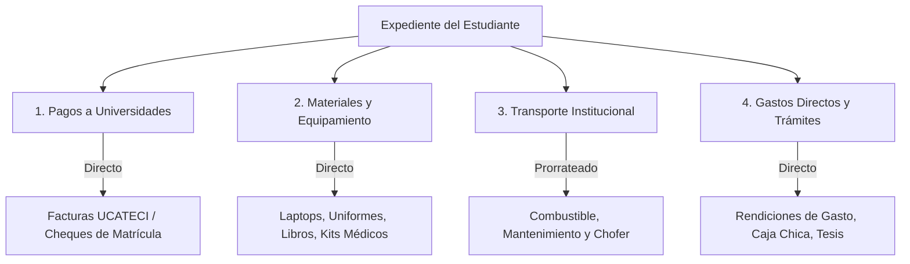

# Plan de Arquitectura y Gestión: Costo Integral por Estudiante Becado (TCO Educativo)

**Proyecto:** Global Effect Nexus  
**Fecha de formulación:** 18 de noviembre de 2026  
**Estado:** Propuesta de arquitectura y diseño administrativo (Plan a futuro)  
**Ubicación:** `docs/estado/plan-costo-por-estudiante.md`  

---

## 1. Justificación y Visión Estratégica

La Fundación Global Effect otorga becas integrales para estudios universitarios (principalmente en UCATECI) y formación complementaria. Actualmente, la contabilidad registra los egresos institucionales a nivel de proveedores, cuentas contables y centros de costo genéricos, pero **no existe trazabilidad directa hacia el expediente individual del estudiante**.

### Problemas que resuelve este plan:
1. **Falta de visibilidad del costo real de un egresado:** La Fundación no cuenta con un cálculo exacto de cuánto dinero requiere graduar a un becado de una carrera específica (p. ej., Medicina vs. Ingeniería vs. Educación).
2. **Desconexión con los Patrocinadores:** Los patrocinadores aportan cuotas fijas periódicas, pero no se puede comparar con precisión matemática si el aporte del patrocinador cubre, excede o es deficitario frente al costo real consumido por el estudiante becado.
3. **Pérdida de costos ocultos:** Gastos en guagua escolar, uniformes, mochilas, copias, libros de texto y trámites de grado suelen diluirse en gastos generales sin imputarse al beneficiario.

---

## 2. Los 4 Pilares del Costo por Estudiante

El modelo divide el costo total acumulado de un estudiante en 4 componentes:



### 1. Pagos Universitarios (Costos Directos Principales)
- Pago de matrícula cuatrimestral y aranceles por crédito.
- Laboratorios, carnets, convalidaciones y derechos de graduación.
- *Fuente:* Facturas de proveedores educativos (`contabilidad.factura_proveedor` / `contabilidad.orden_compra`) donde el proveedor es la Universidad.

### 2. Materiales y Equipamiento (Costos Directos de Inventario)
- Uniformes institucionales, polos, mochilas.
- Laptops o calculadoras asignadas en propiedad o custodia.
- Libros especializados o instrumentos (estetoscopios, libros de leyes, etc.).
- *Fuente:* Salidas de inventario imputadas con su costo promedio ponderado (`contabilidad.articulo_inventario` y `public.material_entrega`).

### 3. Transporte Escolar (Costo Indirecto Prorrateado)
- Costo operativo de la guagua (combustible diésel, mantenimiento de la unidad, seguro y salario del chofer).
- *Mecanismo de costeo:* Cálculo de **Costo Estándar por Cuatrimestre** asignado a cada estudiante activo según su inscripción recurrente (`transporte_inscripcion_recurrente`) y asistencia efectiva a los viajes.

### 4. Gastos Directos y Trámites (Caja Chica y Rendiciones)
- Reembolsos por transporte interurbano extraordinario, viáticos para talleres y congresos.
- Ayudas para impresión de monográficos/tesis y documentos de pasantías.
- *Fuente:* Rendiciones de colaboradores con comprobante fiscal (`public.rendicion_gasto`) o vales de caja chica etiquetados al estudiante.

---

## 3. Modelo de Datos Propuesto

Para implementar este plan sin romper el esquema contable existente ni alterar la partida doble, se aplicará el principio de **etiquetado por llave foránea opcional**:

### A. Migración de Base de Datos (`0086_costo_por_estudiante.sql`)

```sql
-- 1. Añadir estudiante_id a facturas de proveedores (cuando el gasto es nominal)
ALTER TABLE contabilidad.factura_proveedor
  ADD COLUMN IF NOT EXISTS estudiante_id uuid REFERENCES public.estudiante(id) ON DELETE SET NULL;

CREATE INDEX IF NOT EXISTS idx_factura_proveedor_estudiante 
  ON contabilidad.factura_proveedor(estudiante_id) 
  WHERE estudiante_id IS NOT NULL;

-- 2. Añadir estudiante_id a las líneas de órdenes de compra
-- (Permite que una sola orden de compra a la universidad agrupe a varios estudiantes línea por línea)
ALTER TABLE contabilidad.orden_compra_linea
  ADD COLUMN IF NOT EXISTS estudiante_id uuid REFERENCES public.estudiante(id) ON DELETE SET NULL;

CREATE INDEX IF NOT EXISTS idx_orden_compra_linea_estudiante 
  ON contabilidad.orden_compra_linea(estudiante_id) 
  WHERE estudiante_id IS NOT NULL;

-- 3. Añadir estudiante_id a rendiciones de gasto de colaboradores
ALTER TABLE public.rendicion_gasto
  ADD COLUMN IF NOT EXISTS estudiante_id uuid REFERENCES public.estudiante(id) ON DELETE SET NULL;

CREATE INDEX IF NOT EXISTS idx_rendicion_gasto_estudiante 
  ON public.rendicion_gasto(estudiante_id) 
  WHERE estudiante_id IS NOT NULL;

-- 4. Registro histórico de entregas de materiales valoradas
CREATE TABLE IF NOT EXISTS public.estudiante_material_costo (
  id uuid PRIMARY KEY DEFAULT gen_random_uuid(),
  estudiante_id uuid NOT NULL REFERENCES public.estudiante(id) ON DELETE CASCADE,
  articulo_id uuid REFERENCES contabilidad.articulo_inventario(id) ON DELETE SET NULL,
  concepto varchar(150) NOT NULL,
  cantidad integer NOT NULL DEFAULT 1 CHECK (cantidad > 0),
  costo_unitario_dop numeric(12,2) NOT NULL CHECK (costo_unitario_dop >= 0),
  costo_total_dop numeric(12,2) GENERATED ALWAYS AS (cantidad * costo_unitario_dop) STORED,
  fecha date NOT NULL DEFAULT CURRENT_DATE,
  creado_por uuid REFERENCES public.usuario(id),
  creado_en timestamptz NOT NULL DEFAULT now()
);

-- 5. Registro de cuota fija de transporte por cuatrimestre
CREATE TABLE IF NOT EXISTS public.estudiante_transporte_costo (
  id uuid PRIMARY KEY DEFAULT gen_random_uuid(),
  estudiante_id uuid NOT NULL REFERENCES public.estudiante(id) ON DELETE CASCADE,
  periodo_id uuid NOT NULL REFERENCES public.periodo(id) ON DELETE RESTRICT,
  dias_asignados smallint NOT NULL DEFAULT 0,
  costo_asignado_dop numeric(10,2) NOT NULL CHECK (costo_asignado_dop >= 0),
  observaciones text,
  creado_en timestamptz NOT NULL DEFAULT now(),
  CONSTRAINT uq_estudiante_periodo_transporte UNIQUE (estudiante_id, periodo_id)
);
```

### B. Vista Consolidada de Costeo (`v_estudiante_costo_total`)

```sql
CREATE OR REPLACE VIEW public.v_estudiante_costo_total AS
SELECT 
  e.id AS estudiante_id,
  e.nombre,
  e.cedula,
  e.universidad,
  e.programa,
  e.estado,
  e.fecha_ingreso,
  -- 1. Universidad
  COALESCE(u.total_universidad, 0) AS total_universidad,
  -- 2. Materiales
  COALESCE(m.total_materiales, 0) AS total_materiales,
  -- 3. Transporte
  COALESCE(t.total_transporte, 0) AS total_transporte,
  -- 4. Gastos directos / rendiciones
  COALESCE(r.total_rendiciones, 0) AS total_rendiciones,
  -- TOTAL GENERAL
  (COALESCE(u.total_universidad, 0) + 
   COALESCE(m.total_materiales, 0) + 
   COALESCE(t.total_transporte, 0) + 
   COALESCE(r.total_rendiciones, 0)) AS costo_total_acumulado,
  -- Cuatrimestres activos para sacar el promedio
  GREATEST(1, CEIL(EXTRACT(DAYS FROM (COALESCE(e.updated_at, now()) - e.fecha_ingreso)) / 120.0)) AS cuatrimestres_cursados
FROM public.estudiante e
LEFT JOIN (
  -- Gastos de universidad desde órdenes de compra o facturas
  SELECT ocl.estudiante_id, SUM(ocl.monto_total) AS total_universidad
  FROM contabilidad.orden_compra_linea ocl
  JOIN contabilidad.orden_compra oc ON oc.id = ocl.orden_compra_id
  WHERE oc.estado IN ('aprobada', 'facturada') AND ocl.estudiante_id IS NOT NULL
  GROUP BY ocl.estudiante_id
) u ON u.estudiante_id = e.id
LEFT JOIN (
  -- Materiales entregados
  SELECT emc.estudiante_id, SUM(emc.costo_total_dop) AS total_materiales
  FROM public.estudiante_material_costo emc
  GROUP BY emc.estudiante_id
) m ON m.estudiante_id = e.id
LEFT JOIN (
  -- Transporte asignado
  SELECT etc.estudiante_id, SUM(etc.costo_asignado_dop) AS total_transporte
  FROM public.estudiante_transporte_costo etc
  GROUP BY etc.estudiante_id
) t ON t.estudiante_id = e.id
LEFT JOIN (
  -- Rendiciones y reembolsos directos
  SELECT rg.estudiante_id, SUM(rg.monto_total) AS total_rendiciones
  FROM public.rendicion_gasto rg
  WHERE rg.estado = 'aprobada' AND rg.estudiante_id IS NOT NULL
  GROUP BY rg.estudiante_id
) r ON r.estudiante_id = e.id;
```

---

## 4. Diseño de la Interfaz (UI / UX)

### 4.1. Nueva pestaña en el Expediente: `/expedientes/[id]?tab=financiero`
Solo accesible con el permiso `contabilidad.leer` o un nuevo permiso `expedientes.costos.leer`:

1. **Tarjetas KPI Superiores:**
   - **Inversión Total:** Ej. `RD$ 284,500.00`
   - **Costo Promedio por Cuatrimestre:** Ej. `RD$ 35,562.50 / cuatrimestre` (8 cuatrimestres)
   - **Aportes del Patrocinador:** Ej. `RD$ 310,000.00`
   - **Balance / Superávit de Beca:** `+RD$ 25,500.00` (Verde: la donación cubrió el 100% del costo del becado).

2. **Gráfico de Distribución del Gasto (Recharts):**
   - Donut chart con los colores de la marca:
     - Universidad (Turquesa `#2096BA` ~ 68%)
     - Transporte (Gris Azulado `#5FB8D4` ~ 15%)
     - Materiales y Equipos (Oscuro `#0a6a8a` ~ 11%)
     - Trámites y Rendiciones (Tinta `#171A1D` ~ 6%)

3. **Línea de Tiempo y Tabla Desglosada:**
   - Filtro por período académico (ej. `2025-III`, `2026-I`, etc.).
   - Columnas: *Fecha*, *Categoría*, *Concepto*, *Proveedor / Origen*, *NCF / Referencia*, *Monto (DOP)*, *Comprobante*.

### 4.2. Nuevo Reporte Ejecutivo: `/contabilidad/reportes/costo-estudiantes`
- **Tabla comparativa por carrera:**
  - Medicina: promedio RD\$ 420,000 por graduado.
  - Informática: promedio RD\$ 260,000 por graduado.
  - Derecho: promedio RD\$ 240,000 por graduado.
- Exportación a Excel (`exceljs` ya instalado en el proyecto).
- Argumentario para Fundraising: datos exactos para campañas de captación de donantes en EE.UU. y República Dominicana.

---

## 5. Control de Acceso y Reglas de Confidencialidad

1. **Privacidad del Estudiante (Regla Dura):**
   - El estudiante **NUNCA** ve los montos de dinero gastados en su formación en el portal del estudiante (`/portal/estudiante`). La educación es un derecho institucional otorgado por la Fundación y ver cifras monetarias puede generar condicionamiento psicológico o incomodidad.
2. **Docentes y Choferes:**
   - No tienen acceso a esta información (`docente`, `chofer`, `habitudes`).
3. **Roles Autorizados:**
   - `super_admin`: Acceso completo a ver, auditar y exportar.
   - `contabilidad`: Asignación de gastos en facturas/órdenes y visualización de reportes.
   - `admin`: Visualización en el expediente para informes ejecutivos a la Junta Directiva.

---

## 6. Fases de Ejecución Recomendadas

| Fase | Tarea Principal | Esfuerzo Estimado |
|---|---|---|
| **Fase 1: Modelo y Migración** | Crear columnas en `contabilidad.orden_compra_linea`, `factura_proveedor`, `rendicion_gasto` y la vista consolidada. | 1 día |
| **Fase 2: Formularios de Entrada** | Añadir selector de estudiante en el formulario de Orden de Compra y en Rendición de Gastos. | 1-2 días |
| **Fase 3: Asignación de Materiales y Transporte** | Registro de salidas de almacén valoradas y prorrateo cuatrimestral de guagua. | 2 días |
| **Fase 4: Pestaña en Expediente** | Integrar vista de costos e indicadores en la ficha del expediente (`/expedientes/[id]`). | 2 días |
| **Fase 5: Reporte Comparativo** | Pantalla de métricas globales, promedio por carrera y exportación a Excel. | 1 día |

---

## 7. Conclusión

Este plan transforma el expediente del estudiante de un simple archivo curricular a un **registro de inversión de impacto social**. Permite demostrar con datos auditables a los patrocinadores y a la Junta Directiva el retorno y costo eficiente de cada peso invertido en la juventud de La Vega.
