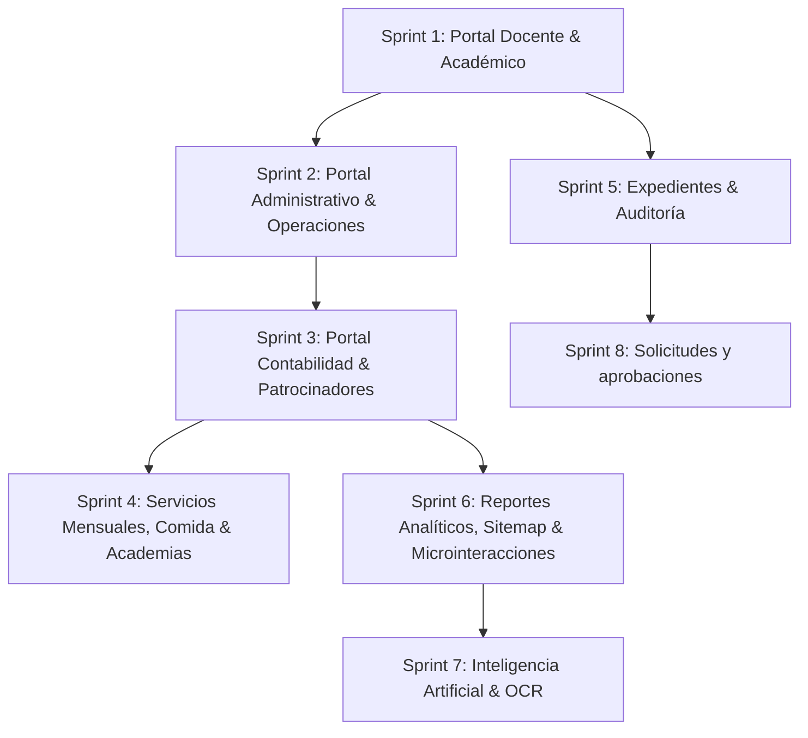

# Plan Maestro de Ejecución por Sprints — Global Effect Nexus

Este plan desglosa la totalidad del proyecto **Global Effect Nexus**, el **ERP institucional** de Global Effect (sistema de gestión con portal del estudiante integrado), detallando el funcionamiento de los **5 portales**, sus **27+ módulos funcionales**, la arquitectura técnica y el conjunto ordenado de **8 Sprints de ejecución** listos para ser entregados a Claude (o ejecutados de forma autónoma) con prompts listos para copiar.

> **Cambio de alcance (oct 2026)**: el departamento de Psicología se eliminó. Su portal, su módulo y su rol desaparecen (migración `0030_fin_de_psicologia.sql`), el expediente pasa a ser de administración (`admin` / `super_admin`), y la cita de psicología del estudiante la sustituye el módulo **Solicitudes y aprobaciones** (migración `0031_solicitudes_y_aprobaciones.sql`, Sprint 8).

> **Cambio de alcance (24 oct 2026)**: la Fundación dejó de impartir cursos técnicos. La migración `0047_fin_de_cursos_tecnicos.sql` borra `curso` y `calificacion` y retira el estudiante `regular`: todo estudiante es becado universitario. Global Effect 360 ocupa el lugar de los cursos —docente, tareas, entregas y nota final—, está abierto a todos, su catálogo entero es obligatorio y cada cuatrimestre tiene dos tandas de dos meses con **una** materia por tanda. `/academico/cursos` pasa a ser `/academico/clases-360` y `/academico/calificaciones` desaparece. Los sprints de abajo se escribieron antes y conservan su redacción donde cuentan historia.

---

## 1. Arquitectura y Reglas Críticas del Proyecto

Antes de iniciar cualquier sprint, Claude/el agente debe respetar rigurosamente estas reglas existentes en el repositorio:

### A. Paleta de Marca y Diseño (`docs/09-sistema-visual.md` y `src/lib/paleta.ts`)
- **Regla dura**: Solo se permiten tonos derivados de la marca:
  - Primario oscuro: `#171A1D` (texto, encabezados, bordes oscuros)
  - Primario de marca: `#2096BA` (botones principales, acentos, links, foco)
  - Variantes de acento: `#187a99`, `#0a6a8a`, `#5FB8D4`
  - Fondo neutro / blanco: `#FFFFFF`, `bg-slate-50`, `border-slate-200`
- **Excepción SEMAFORO**: Únicamente `#1E9E6A` (verde "dentro/activo") y `#B4342B` (rojo "requiere acción/reprobado") para estados puntuales y alertas críticas.
- **Prohibido**: Clases de Tailwind como `bg-emerald-500`, `text-rose-600`, `bg-violet-500`, `text-amber-500` en componentes servidos.

### B. Base de Datos y Consultas (`src/lib/db.ts`)
- Usar `consultar<T>(sql, params)`, `consultarUna<T>(sql, params)` o `enTransaccion(async (client) => { ... })`.
- **NO existe** `db.query` ni ORM Prisma. Siempre SQL parametrizado (`$1, $2, ...`).

### C. Autenticación y Control de Acceso RBAC (`src/lib/auth.ts`)
- Proteger cada Server Action y carga de página con:
  - `await requerirUsuario()`
  - `await requerirRol(['admin', 'profesor', ...])`
  - `await requerirPermiso('modulo.accion')`

### D. Auditoría (`src/lib/auditoria.ts`)
- Toda mutación crítica (crear, editar, eliminar registros sensibles) debe llamar a `registrar(accion, tabla, registroId, detalle, usuarioId)`.

### E. Internacionalización i18n (`messages/es.json` y `messages/en.json`)
- Toda etiqueta debe añadirse simétricamente en ambos archivos. Comprobar con `npm run i18n:check`.

---

## 2. Mapa Completo de Portales y Módulos

| Portal | Rol Principal | Dashboard / Ruta Base | Módulos Asignados |
|---|---|---|---|
| **Portal 1: Administrador** | `admin` | `/dashboard` | Clases de 360, Materias, Historial, Prematrícula (GE 360), Períodos, Academias, Expedientes, Patrocinadores, Becas, Tareas, Proyectos, Personal, Servicios Mensuales, Comida, Contabilidad, Solicitudes y aprobaciones, Reportes, Chat IA, Calendario, Configuración |
| **Portal 2: Estudiante** | `estudiante` | `/portal/estudiante` | Mi Portal, Mis Materias, Calificaciones, Global Effect 360, Aula Virtual (entrega PDF), Calendario, Chat IA Estudiantil, Solicitudes (trámites: constancia, carta, cita con administración, permiso) |
| **Portal 3: Profesor** | `profesor` | `/portal/profesor` | Mi Portal (dashboard docente), Mis clases de 360 (`/academico/clases-360`, con la nota final de cada inscripción), Materias (`/academico/materias`), Calendario |
| **Portal 4: Administrativo** | `administrativo` | `/portal/administrativo` | Mi Portal (incluye solicitudes por atender), Expedientes, Patrocinadores, Servicios Mensuales, Lista de Comida, Tareas, Proyectos, Solicitudes y aprobaciones (`/administrativo/solicitudes`), Calendario, Chat IA |
| **Portal 5: Contabilidad** | `contabilidad` | `/portal/contabilidad` | Mi Portal (resumen financiero), Contabilidad (ingresos/egresos), Reportes financieros |
| **Público & Compartidos** | Público / Todos | `/` (Landing), `/login`, `/comida` | Inscripción Comida sin cuenta |

---

## 3. Plan de Sprints para Claude

A continuación se detallan los 8 Sprints en orden secuencial de dependencias. Cada sprint cuenta con su objetivo, archivos a tocar, validación y el **prompt textual listo para pasarle a Claude**.



---

### SPRINT 1: Portal Docente y Módulos Académicos Core ✅ (COMPLETADO AL 100%)

> **Estado**: **100% Funcional**. Cerrado con éxito.
> - `/academico/periodos`: CRUD con coherencia de fechas y recuento de materias vinculadas.
> - `/academico/materias`: Catálogo completo, asignación de docentes y filtros en URL.
> - `/academico/calificaciones`: Registro, edición y desglose por bandas con escala `src/lib/notas.ts` (retirado en la 0047, oct 2026: eran las notas por evaluación de los cursos técnicos; la nota final de 360 se pone en `/academico/clases-360`).
> - `/academico/historial`: Historial consolidado con índice real guardado, 100% SSR.
> - `/portal/profesor`: Dashboard conectado con `cifrasDocente()`, materias asignadas, clases de 360 y entregas pendientes (la lista de cursos técnicos se retiró en la 0047).

---

### SPRINT 2: Portal Administrativo & Operaciones (Tareas, Proyectos) ⏳ (3 DE 4)

> **Estado**: **3 de 4 completado**.
> - `/administrativo/personal`: ✅ **Funcional** (alta de cuentas, cambio de roles y reseteo).
> - `/administrativo/tareas`: ✅ **Funcional**. Tablero de tres columnas con arrastre nativo **y** botón para empujar a la siguiente (sin él no se podría mover con teclado). El alta escribe en `tarea`, `tarea_asignado`, `evento` (solo si hay fecha límite: `evento.fecha` es NOT NULL) y `notificacion`, todo dentro de `enTransaccion()`. Primera pantalla que usa `tarea.visibilidad`.
> - `/administrativo/proyectos`: ✅ **Funcional**. Alta, edición y avance **contado** desde las tareas completadas — no la columna `proyecto.progreso`, que dice 0% mientras el avance real es 33% y 25%. Las canceladas salen del denominador.
> - **Queda 1, y hay que decidir si se hace**:
>   1. `/portal/administrativo`: el plan lo pide para un rol `administrativo` que **no existe** en `rbac.ts` —los roles son `super_admin`, `admin`, `docente`, `estudiante`, `contabilidad` y `habitudes` (el rol `psicologo` existía entonces; la 0030 lo eliminó)— y `admin` ya entra por `/dashboard`, que está completo (cifras, gráficas, tareas, proyectos y eventos). Tal como está descrito, sería duplicar el panel para nadie. O se descarta, o se dice qué tendría que enseñar que `/dashboard` no enseñe ya.
>
> **Correcciones al prompt de abajo**, escrito antes de mirar el repo:
> - Los archivos de servidor no son `tareas.ts` / `proyectos.ts` / `personal.ts` sueltos, sino un `consultas.ts` y un `acciones.ts` en `src/server/operaciones/` (partirlos por tabla duplicaría el ayudante de refresco y el de UUID).
> - El aviso al asignado **no es por correo**: este proyecto no tiene ninguna infraestructura de correo. Se escribe en `notificacion`, y la copia que prometía un correo se corrigió.
> - Un componente cliente solo puede importar **tipos** de `@/server/**/consultas`. Importar un valor arrastra `pg` al navegador y devuelve 500. Lo compartido va en `src/lib/` (ver `src/lib/operaciones.ts`).

- **Módulos afectados**:
  1. `/portal/administrativo` (Nueva ruta: métricas de tareas urgentes, proyectos activos, accesos directos).
  2. `/administrativo/tareas` (Tablero Kanban de 3 columnas: Pendiente, En Progreso, Completada. Al asignar crea evento en calendario y registro en `notificacion`).
  3. `/administrativo/proyectos` (CRUD de proyectos, cálculo de avance según tareas completadas).
  4. `/administrativo/personal` (Directorio de colaboradores, asignación de roles y permisos).
- **Tablas involucradas**: `tarea`, `proyecto`, `evento`, `notificacion`, `usuario`, `rol`, `rol_permiso`.
- **Archivos a crear/modificar**:
  - `src/server/portales/administrativo.ts` [NEW]
  - `src/server/operaciones/tareas.ts` [NEW]
  - `src/server/operaciones/proyectos.ts` [NEW]
  - `src/server/operaciones/personal.ts` [NEW]
  - `src/app/[locale]/(portal)/portal/administrativo/page.tsx` [NEW]
  - `src/app/[locale]/(portal)/administrativo/tareas/page.tsx` [MODIFY]
  - `src/app/[locale]/(portal)/administrativo/proyectos/page.tsx` [MODIFY]
  - `src/app/[locale]/(portal)/administrativo/personal/page.tsx` [MODIFY]
  - `src/components/operaciones/*` [NEW: KanbanBoard, TareaCard, ModalTarea, ModalProyecto]
  - `src/lib/nav.ts` (asegurar que el enlace del portal administrativo redirige correctamente).
  - `messages/es.json` y `messages/en.json` (namespace `operations`, `tasks`, `projects`).

#### 📋 Prompt para Claude — Sprint 2:
```markdown
Hola Claude, vamos a ejecutar el SPRINT 2 de Global Effect Nexus: "Portal Administrativo & Operaciones (Tareas, Proyectos, Personal)".
Sigue rigurosamente las reglas del proyecto:
1. Crea la ruta que falta: `src/app/[locale]/(portal)/portal/administrativo/page.tsx` usando `BannerPortal` y `AccesosPortal` de `@/components/layout/banner-portal`, con KPIs de tareas y proyectos, y lista de tareas urgentes.
2. Implementa `/administrativo/tareas`: Tablero Kanban de 3 columnas (Pendiente, En Progreso, Completada) con prioridades (baja, media, alta, urgente usando `PRIORIDAD` de `src/lib/paleta.ts`).
   - Al crear una tarea en `src/server/operaciones/tareas.ts`, usa `enTransaccion()` para: insertar en `tarea`, insertar en `evento` (para el calendario institucional) e insertar en `notificacion` para el usuario asignado.
3. Implementa `/administrativo/proyectos`: Tarjetas con barra de progreso (% de avance según tareas), estado y responsable. Modal para nuevo proyecto.
4. Implementa `/administrativo/personal`: Lista de usuarios institucionales con avatar, rol y selector para cambiar roles validado por `admin`.
5. Estilos estrictos: paleta `#2096BA`, `#171A1D`, bordes slate.
6. Actualiza `messages/es.json` y `messages/en.json` y verifica con `npm run i18n:check` y `npx tsc --noEmit`.
```

---

### SPRINT 3: Portal Contabilidad & Patrocinadores (Finanzas y Becas)
> **Objetivo**: Conectar el Portal de Contabilidad (`/portal/contabilidad`), el módulo de finanzas (`/contabilidad`), y el sistema de patrocinio y asignación de becas (`/patrocinadores` y `/patrocinadores/becas`).

- **Módulos afectados**:
  1. `/portal/contabilidad` (KPIs reales: ingresos del mes, egresos del mes, balance neto, y tabla de últimas 10 transacciones).
  2. `/contabilidad` (Gestión completa de transacciones: filtro por tipo/categoría/fecha, modal de alta con registro en `audit_log`, formato monetario).
  3. `/patrocinadores` (Directorio de donantes/patrocinadores, tipo individual/corporativo, país, aporte mensual).
  4. `/patrocinadores/becas` (Asignación de beca: vincular estudiante becado con patrocinador, monto asignado, notas).
- **Tablas involucradas**: `transaccion`, `patrocinador`, `beca`, `estudiante`, `audit_log`.
- **Archivos a crear/modificar**:
  - `src/server/portales/contabilidad.ts` [NEW]
  - `src/server/finanzas/transacciones.ts` [NEW]
  - `src/server/patrocinadores/patrocinadores.ts` [NEW]
  - `src/app/[locale]/(portal)/portal/contabilidad/page.tsx` [MODIFY]
  - `src/app/[locale]/(portal)/contabilidad/page.tsx` [MODIFY]
  - `src/app/[locale]/(portal)/patrocinadores/page.tsx` [MODIFY]
  - `src/app/[locale]/(portal)/patrocinadores/becas/page.tsx` [MODIFY]
  - `src/components/finanzas/*` [NEW: ModalTransaccion, TablaTransacciones, ResumenBalance]
  - `src/components/patrocinadores/*` [NEW: ModalPatrocinador, ModalAsignarBeca]
  - `messages/es.json` y `messages/en.json` (namespace `finance`, `sponsors`).

#### 📋 Prompt para Claude — Sprint 3:
```markdown
Hola Claude, vamos a ejecutar el SPRINT 3 de Global Effect Nexus: "Portal Contabilidad & Patrocinadores (Finanzas y Becas)".
Sigue rigurosamente las reglas del proyecto:
1. En `/portal/contabilidad` y `/contabilidad`, los ingresos se identifican en azul de marca (`#2096BA`) y los egresos en neutro oscuro (`#171A1D`) usando `MOVIMIENTO` de `src/lib/paleta.ts`. NUNCA verde ni rojo común.
2. Implementa Server Actions en `src/server/finanzas/transacciones.ts`:
   - `obtenerResumenFinanciero()`: KPIs de ingresos, egresos y balance.
   - `crearTransaccion()`: registra la transacción y llama a `registrar()` de `@/lib/auditoria`.
3. Implementa `/patrocinadores`: Grid y tabla de donantes con filtros, buscador por país/nombre, y modal para registrar o editar patrocinador.
4. Implementa `/patrocinadores/becas`: Panel de asignación de becas estudiante ↔ donante, mostrando estudiantes del programa Global Effect 360 y su estado.
5. Permisos: Rol `contabilidad` y `admin` tienen permiso de escritura en finanzas; `administrativo` solo lectura.
6. Actualiza `messages/es.json` y `messages/en.json` y verifica con `npm run i18n:check` y `npx tsc --noEmit`.
```

---

### SPRINT 4: Bienestar, Vida Estudiantil & Operaciones Diarias
> **Objetivo**: Reemplazar los esqueletos de `/servicios-mensuales`, `/inscripcion-comida` (vista interna admin) y los módulos de academias (`/academias/programas` y `/academias/materiales`).

- **Módulos afectados**:
  1. `/servicios-mensuales` (Control mensual estilo planilla de cálculo para servicio comunitario y asistencia a reunión mensual, con filtro por mes y exportación imprimible).
  2. `/inscripcion-comida` (Panel administrativo interno para el comedor: lista de comensales inscritos en el día, corte a las 8:30 AM, conteo por programa, impresión para cocina).
  3. `/academias/programas` (Gestión de programas de liderazgo y habilidades blandas: facilitador, horario, cupos).
  4. `/academias/materiales` (Repositorio de materiales educativos: PDF, guías, videos por programa).
- **Tablas involucradas**: `registro_servicio_mensual`, `inscripcion_comida`, `programa_academia`, `material_academia`, `estudiante`.
- **Archivos a crear/modificar**:
  - `src/server/operaciones/servicios.ts` [NEW]
  - `src/server/comida/admin.ts` [NEW]
  - `src/server/academias/programas.ts` [NEW]
  - `src/app/[locale]/(portal)/servicios-mensuales/page.tsx` [MODIFY]
  - `src/app/[locale]/(portal)/inscripcion-comida/page.tsx` [MODIFY]
  - `src/app/[locale]/(portal)/academias/programas/page.tsx` [MODIFY]
  - `src/app/[locale]/(portal)/academias/materiales/page.tsx` [MODIFY]
  - `src/components/bienestar/*` [NEW: TablaServicios, PlanillaComida, CardPrograma]
  - `messages/es.json` y `messages/en.json` (namespace `monthlyServices`, `lunchAdmin`, `academies`).

#### 📋 Prompt para Claude — Sprint 4:
```markdown
Hola Claude, vamos a ejecutar el SPRINT 4 de Global Effect Nexus: "Bienestar, Vida Estudiantil & Operaciones Diarias".
Sigue rigurosamente las reglas del proyecto:
1. `/servicios-mensuales`: Tabla estilo hoja de cálculo donde cada fila es un estudiante activo, con selector de mes (últimos 12 meses), checkboxes interactivos para "Servicio Comunitario" y "Reunión Mensual" (que guardan inmediatamente mediante Server Action), y botón para imprimir reporte/PDF amigable para impresión (`@media print`).
2. `/inscripcion-comida`: Pantalla administrativa que muestra las reservas de comida del día registradas desde `/comida`. Agrupa por rol/programa, muestra hora de inscripción, totalizador y vista para imprimir la lista de cocina.
3. `/academias/programas`: CRUD de programas extracurriculares (liderazgo, habilidades para la vida, inglés vocacional).
4. `/academias/materiales`: Repositorio ordenado de recursos educativos por programa con enlaces descargables y visor de tipos.
5. Usa la paleta corporativa y animaciones sutiles.
6. Actualiza `messages/es.json` y `messages/en.json` y valida con `npm run i18n:check` y `npx tsc --noEmit`.
```

---

### SPRINT 5: Expedientes Cierre (Alta Completa y Auditoría)
> **Objetivo**: Completar las tareas pendientes críticas de los expedientes estudiantiles (habilitar el alta de nuevo estudiante que escribe en las 6 tablas en una sola transacción) y construir el visor de auditoría para super admin (`/configuracion/auditoria`).
>
> **Parte de Psicología: descartada — el departamento de Psicología se eliminó (oct 2026).** Las tareas #423 (registro de nueva cita), #428 (auditoría de lectura de la ficha clínica) y #433 (notificaciones al psicólogo) ya no aplican: la migración `0030_fin_de_psicologia.sql` borró `cita_psicologia`, `nota_psicologica` y `perfil_psicologico`. El expediente lo administran `admin` y `super_admin` sobre todos los estudiantes, y lo que el estudiante pedía como cita ahora lo pide en Solicitudes (Sprint 8).

- **Módulos afectados**:
  1. `/expedientes` (Habilitar el diálogo "Nuevo Expediente", Server Action `crearExpediente` que guarda en cascada: `estudiante`, `perfil_vivienda`, `perfil_salud`, `perfil_socioeconomico`, `familiar`, `audit_log`).
  2. `/configuracion/auditoria` [NEW] (Pantalla para que el Administrador Maestro visualice los eventos registrados en `audit_log`).
- **Tablas involucradas**: `estudiante`, `perfil_vivienda`, `perfil_salud`, `perfil_socioeconomico`, `familiar`, `audit_log`.
- **Archivos a crear/modificar**:
  - `src/server/expedientes/acciones.ts` [MODIFY: activar `crearExpediente` con `enTransaccion`]
  - `src/components/expedientes/dialogo-nuevo-expediente.tsx` [MODIFY]
  - `src/app/[locale]/(portal)/configuracion/auditoria/page.tsx` [NEW]
  - `src/server/auditoria/consultas.ts` [NEW]
  - `messages/es.json` y `messages/en.json`.

#### 📋 Prompt para Claude — Sprint 5:
```markdown
Hola Claude, vamos a ejecutar el SPRINT 5 de Global Effect Nexus: "Expedientes Cierre (Alta Completa y Auditoría)".
Sigue rigurosamente las reglas del proyecto:
1. En `src/server/expedientes/acciones.ts`: Implementa `crearExpediente()` utilizando `enTransaccion()`. Debe crear el registro en `estudiante` y sus perfiles relacionados (`perfil_vivienda`, `perfil_salud`, `perfil_socioeconomico`, `familiar`) y emitir un registro en `audit_log`.
2. En `src/components/expedientes/dialogo-nuevo-expediente.tsx`: Desbloquea el botón "Guardar Expediente", conecta el submit al Server Action y maneja retroalimentación (loading spinner y notificación toast/banner).
3. Crea la pantalla `/configuracion/auditoria` solo accesible por rol `admin`, permitiendo filtrar `audit_log` por tabla, acción, usuario y fecha.
4. Actualiza `messages/es.json` y `messages/en.json` y valida con `npm run i18n:check` y `npx tsc --noEmit`.
```

---

### SPRINT 6: Reportes Analíticos, Sitemap & Pulido Global de Microinteracciones
> **Objetivo**: Implementar el módulo de Reportes analíticos (`/reportes`) con gráficos Recharts respetando la paleta estricta, la página de Mapa del Sitio (`/sitemap`), y aplicar un barrido integral de microinteracciones en tarjetas, botones y tablas de todos los portales.

- **Módulos afectados**:
  1. `/reportes` (3 pestañas funcionales: Proyectos/Operaciones, Rendimiento Académico y Finanzas/Donaciones, usando Recharts con `SERIE` y `GRAFICA` de `paleta.ts`).
  2. `/sitemap` (Matriz interactiva con los 5 portales, enlaces rápidos, estado de permisos y módulos compartidos).
  3. Barrido visual transversal: aplicar transiciones consistentes (`hover:shadow-md`, `hover:-translate-y-0.5`, `group-hover:scale-110`, indicadores de carga en botones).
- **Archivos a crear/modificar**:
  - `src/server/reportes/consultas.ts` [NEW]
  - `src/app/[locale]/(portal)/reportes/page.tsx` [MODIFY]
  - `src/components/reportes/*` [NEW: GraficosProyectos, GraficosAcademico, GraficosFinanzas]
  - `src/app/[locale]/(portal)/sitemap/page.tsx` [MODIFY]
  - `src/components/layout/sidebar.tsx` [MODIFY: microinteracciones]
  - `messages/es.json` y `messages/en.json`.

#### 📋 Prompt para Claude — Sprint 6:
```markdown
Hola Claude, vamos a ejecutar el SPRINT 6 de Global Effect Nexus: "Reportes Analíticos, Sitemap & Pulido Global de Microinteracciones".
Sigue rigurosamente las reglas del proyecto:
1. En `/reportes`: Construye los reportes analíticos con Recharts en tres pestañas:
   - Operaciones y Proyectos: distribución por estado y % de avance medio.
   - Académico: promedios por materia y por clase de 360, distribución de notas según rampa de notas.
   - Contabilidad: barras de ingresos vs egresos por mes y desglose por categorías.
   - IMPORTANTE: Todos los gráficos deben usar los colores de `GRAFICA` y `SERIE` definidos en `src/lib/paleta.ts` (tonos de #2096BA y #171A1D). No uses colores por defecto de Recharts.
2. En `/sitemap`: Diseña un mapa del sitio elegante y moderno que muestre los 5 portales, sus rutas, descripciones y estado de acceso según el rol del usuario conectado.
3. Realiza el barrido de microinteracciones descrito en `docs/estado/plan-etapas.md`: hover effects refinados en tarjetas, transiciones suaves y estados de carga en botones.
4. Actualiza `messages/es.json` y `messages/en.json` y verifica con `npm run i18n:check` y `npx tsc --noEmit`.
```

---

### SPRINT 7: Inteligencia Artificial Institucional & OCR
> **Objetivo**: Habilitar el Asistente IA Institucional (`/chat-ia`) y el asistente OCR para extracción automática de datos desde documentos de identidad en Expedientes (depende de configurar una `ANTHROPIC_API_KEY` activa).

- **Módulos afectados**:
  1. `/chat-ia` (Chatbot para administradores y coordinadores con herramientas RAG para consultar métricas, estudiantes y eventos institucionales).
  2. OCR en Expedientes (Extracción de nombre, cédula y fecha de nacimiento desde documento subido en Storage).
- **Archivos a crear/modificar**:
  - `src/server/ia/chat-admin.ts` [NEW]
  - `src/server/ia/ocr-expediente.ts` [NEW]
  - `src/app/[locale]/(portal)/chat-ia/page.tsx` [MODIFY]
  - `src/components/chat-ia/*` [NEW]
  - `src/components/expedientes/ocr-scanner.tsx` [NEW]

#### 📋 Prompt para Claude — Sprint 7:
```markdown
Hola Claude, vamos a ejecutar el SPRINT 7 de Global Effect Nexus: "Inteligencia Artificial Institucional & OCR".
Nota previa: Requiere ANTHROPIC_API_KEY configurada en .env.local.
1. En `/chat-ia`: Implementa la interfaz de chat institucional para administradores, integrando el SDK `@anthropic-ai/sdk`. Incluye sugerencias de preguntas rápidas (balance del mes, estudiantes en riesgo académico, resumen de proyectos).
2. En `src/server/ia/chat-admin.ts`: Construye un system prompt enriquecido con las estadísticas clave del sistema (agregados de alumnos, proyectos y finanzas sin filtrar datos confidenciales de los expedientes).
3. En Expedientes: Añade componente de OCR para escaneo de cédula/documento, enviando la imagen a Claude Vision para precargar los campos de nombre, fecha de nacimiento y cédula en el formulario.
4. Valida i18n, TypeScript y ausencia de colores fuera de la paleta.
```

---

### SPRINT 8: Solicitudes y aprobaciones ✅ (CONSTRUIDO EN EL CAMBIO DE ALCANCE DE OCT 2026)
> **Objetivo**: Sustituir la cita de psicología por una sola bandeja de solicitudes con flujo por pasos, y dar al ERP los controles que le faltaban: segundo nivel de aprobación, separación de funciones y trazabilidad.
>
> **Estado**: **Construido**. Migraciones `0030_fin_de_psicologia.sql` (las cuentas `psicologo` pasan a `admin`; se borran el rol, `psicologia.leer` / `psicologia.escribir`, las tres tablas clínicas y `estudiante.psicologo_id`; el `audit_log` no se toca) y `0031_solicitudes_y_aprobaciones.sql` (tablas `solicitud` y `solicitud_paso`, permisos `solicitudes.gestionar` y `solicitudes.direccion`).

- **Módulos afectados**:
  1. `/portal/estudiante/solicitudes` (Trámites del estudiante: `constancia`, `carta`, `cita_administracion` con fecha y hora preferidas, `permiso`, `otro`. Formulario + "mis solicitudes" con línea de tiempo).
  2. `/administrativo/solicitudes` (Bandeja del personal: "por atender" según permisos, "mis solicitudes", alta de solicitud interna y acciones del flujo con comentario. Aprobaciones internas: `alta_expediente`, `beca` —siempre con dirección— y `gasto` —monto en USD, dirección si es ≥ 1,000 USD, la revisa `finanzas.escribir`—).
  3. `/portal/administrativo` (Cuenta las solicitudes por atender en lugar de citas).
  4. Calendario del estudiante (Muestra sus `cita_administracion` aprobadas o en curso).
- **Flujo**: `enviada` → `en_revision` → [`pendiente_direccion`] → `aprobada` → `completada`. Se puede `rechazada` (comentario obligatorio) desde enviada, en_revision o pendiente_direccion; el solicitante puede `cancelada` mientras esté en enviada o en_revision.
- **Reglas de control**: nadie aprueba su propia solicitud; `requiere_direccion` se fija al crear; "aprobada" es la decisión y "completada" es que el módulo dueño ya la ejecutó (la solicitud no ejecuta efectos por su cuenta); cada paso queda en `solicitud_paso` y notifica en `notificacion` (sin correo); aprobar, rechazar y completar se registran en `audit_log`; cada solicitud tiene un `folio` legible.
- **Tablas involucradas**: `solicitud`, `solicitud_paso`, `notificacion`, `audit_log`, `estudiante`.

---

## 4. Guía de Ejecución y Checklist por Sprint

Para cada sprint ejecutado con Claude, se debe exigir la siguiente verificación de fin de sprint:

```bash
# 1. Comprobar que no se introdujeron colores prohibidos en Tailwind
grep -rE '(bg|text|border|from|to|via|ring|fill|stroke|divide)-(emerald|amber|orange|rose|violet|red|green|yellow|purple|teal|pink|indigo|lime|fuchsia|cyan|sky)-[0-9]' src/

# 2. Comprobar que no hay errores de internacionalización
npm run i18n:check

# 3. Comprobar tipos de TypeScript y linting
npx tsc --noEmit && npm run lint
```
